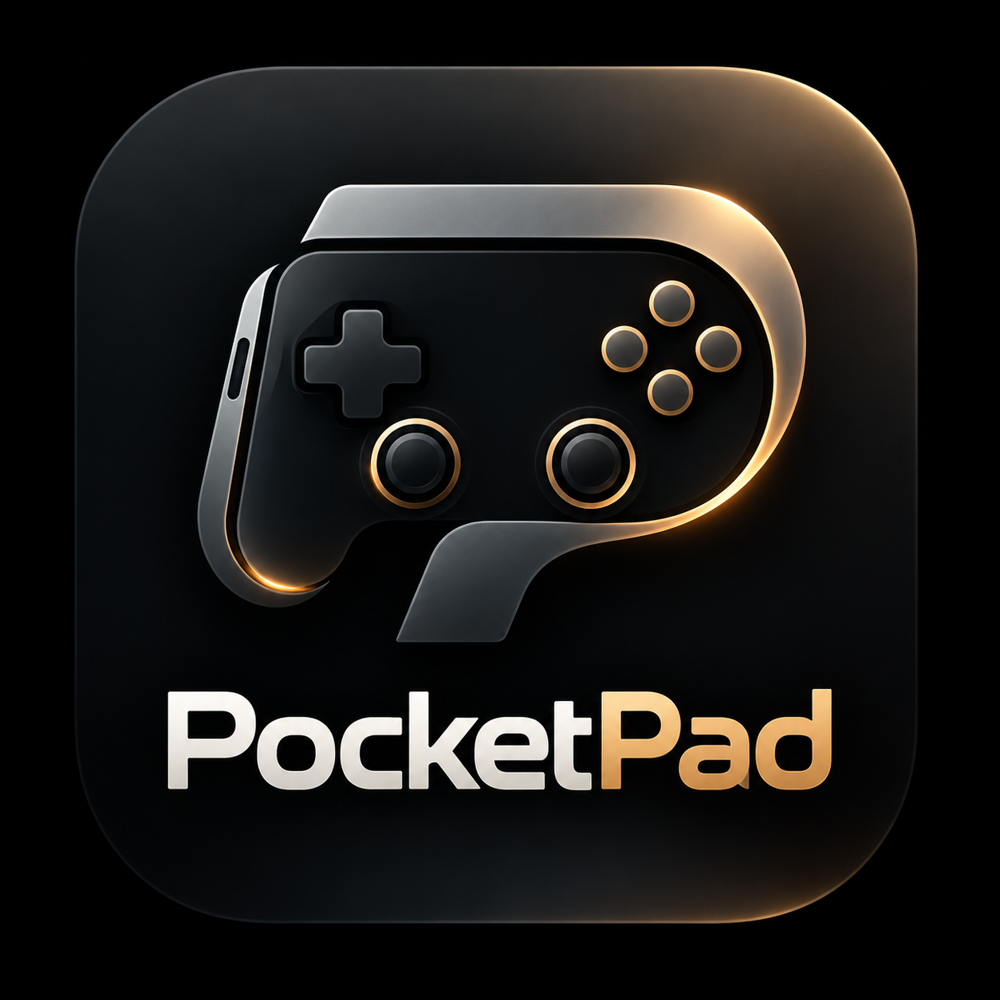

# PocketPad



PocketPad turns an Android phone into a low-latency game controller for
Windows and macOS. It works over your local network and needs no accounts,
no cloud service and no internet connection.

## How it works

The phone runs the PocketPad app. The computer runs a small receiver,
`pocketpad`. The two connect in one of two ways:

- **Wi-Fi.** The phone sends compact, authenticated UDP packets to the
  receiver. The receiver then drives a controller the operating system can
  see (or, on macOS 26, the keyboard and mouse).
- **Bluetooth.** The phone itself becomes a standard Bluetooth game
  controller. Nothing needs to run on the computer. This only works on
  phones whose Android build includes the Bluetooth HID Device profile.

## Platform support

| Computer | Wi-Fi mode: what games see | Requirements | Rumble |
|---|---|---|---|
| Windows 10/11 | Xbox 360 controller | ViGEmBus driver and `ViGEmClient.dll` | Yes |
| macOS 15 and earlier | HID gamepad | Run the receiver with `sudo` | No |
| macOS 26 | Keyboard and mouse, with per-game profiles | Accessibility permission | No |
| Linux | Diagnostics only | None | No |

On macOS 26, the receiver falls back to keyboard and mouse because Apple
now requires an entitlement it grants case by case before an app can create
a virtual gamepad. See [docs/GETTING_STARTED.md](docs/GETTING_STARTED.md) for
details and the key mappings.

The phone app requires Android 9 (API 28) or later.

## Quick start

1. **Computer.** Build and start the receiver (Go 1.24 or later):

   ```sh
   cd desktop
   go build -o pocketpad ./cmd/pocketpad
   ./pocketpad serve
   ```

   The banner prints the computer's address and the pairing code. On a Mac,
   `./scripts/build-mac-app.sh` builds `PocketPad.app` instead: a window
   that shows a QR code for pairing.

2. **Phone.** Install the app. Download the APK from the
   `pocketpad-android-debug` artifact of the latest CI run, or build it
   yourself:

   ```sh
   cd android
   ./gradlew :app:assembleDebug
   adb install -r app/build/outputs/apk/debug/app-debug.apk
   ```

3. **Pair.** Open the app on the same Wi-Fi network, then either tap the
   discovered computer and enter the pairing code, or scan the QR code shown
   by the Mac app.

The full walkthrough, including Windows driver setup, macOS permissions and
troubleshooting, is in [docs/GETTING_STARTED.md](docs/GETTING_STARTED.md).

## Documentation

| Document | Contents |
|---|---|
| [docs/GETTING_STARTED.md](docs/GETTING_STARTED.md) | Installation, pairing, controls, settings and troubleshooting |
| [docs/DEVELOPMENT.md](docs/DEVELOPMENT.md) | Architecture, building, testing and design rules |
| [docs/protocol.md](docs/protocol.md) | The wire protocol (normative) |
| [docs/ROADMAP.md](docs/ROADMAP.md) | Project status and remaining work |

## Repository layout

```
android/
  app/                 Android app (Kotlin, Jetpack Compose)
  protocol/            Protocol library for the app (pure Kotlin/JVM)
desktop/               Receiver (Go)
  cmd/pocketpad/       Receiver CLI and macOS app window
  cmd/ppsim/           Phone simulator for testing without a phone
  internal/            Protocol, session manager, gamepad backends, configuration
docs/                  Documentation
protocol/testvectors/  Test vectors shared by the Go and Kotlin implementations
scripts/               macOS app bundle and signing helpers
```

## Security

Pairing uses a 120-bit secret generated by the receiver and shown as a
24-character code. Every connection derives fresh session keys, and every
packet carries an HMAC tag, so other devices on the network cannot inject
input or replay old packets. The receiver never trusts a packet just because
it comes from the local network.

## Safety

Held inputs are always released when input stops: the receiver releases
everything after 300 ms without input, ends the session after 3 s of
silence, and starts every new session with everything released. A lost
release event cannot leave a button stuck.
